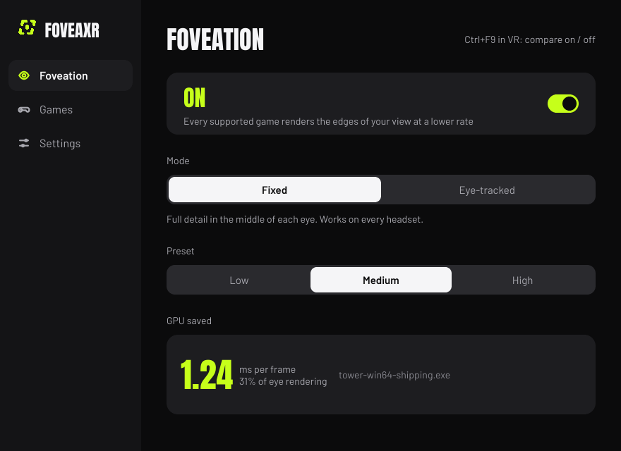
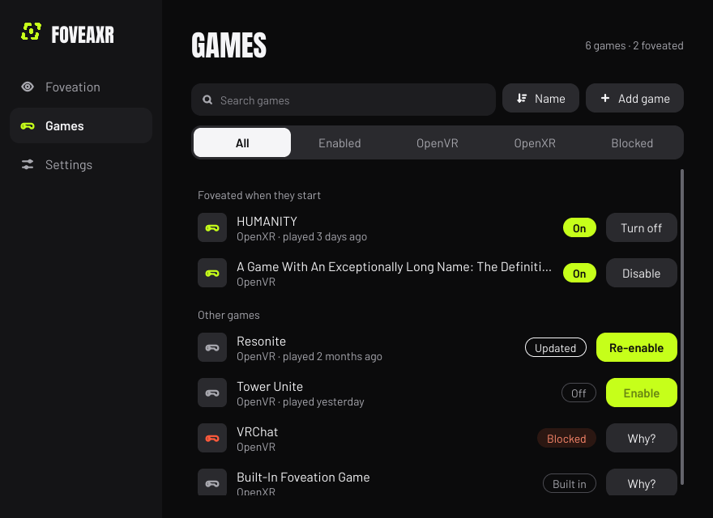

<picture>
  <source media="(prefers-color-scheme: dark)" srcset="packaging/brand/foveaxr-mark.svg">
  
</picture>

# FoveaXR: foveated rendering for any PC VR game

[](https://github.com/EncidXVII/FoveaXR/actions/workflows/ci.yml)
[](https://github.com/EncidXVII/FoveaXR/releases/latest)
[](https://github.com/EncidXVII/FoveaXR/releases)
[](LICENSE)

**FoveaXR is a free, open-source tool that adds foveated rendering to the PC VR games you already own.** Fixed
foveation for every headset, eye-tracked (experimental) for Steam Frame and other eye-tracking headsets. It works in SteamVR
(OpenVR) and OpenXR games without mods or per-game patches: install it, start the game, get GPU time back.

**[Download the latest release](https://github.com/EncidXVII/FoveaXR/releases/latest)** · [Guides and help on everyvr.net](https://everyvr.net/foveaxr) · [Discord](https://discord.gg/WkzGQwu2kz) · [Supported GPUs and games](#supported) · [Common questions](#common-questions) · [Limits](#limits)

> **Status: early access (0.4), fixed foveation on Windows.** Eye-tracked mode and the Linux build are
> experimental. Game reports (what a game saved, or that it saved nothing) are what it needs most:
> see [Status and help wanted](#status-and-help-wanted).

| Foveation | Games |
|---|---|
|  |  |

The edge of each eye's view is shaded more coarsely than the centre, where you look, so the GPU does less work per
frame. On the test scene (a pixel-heavy fixture) eye rendering took 1.37 ms without and 0.25 ms with the High preset.
Real games save less: how much depends on how much of their frame is pixel shading. Measure your own with Ctrl+F9.

## At a glance

| | |
|---|---|
| **What it is** | Foveated rendering for PC VR games that have none: the edge of each eye's view is shaded at a lower rate than the centre, so the GPU does less work per frame |
| **Use it for** | More frames per second or a higher resolution in SteamVR and OpenXR games, with no change to the game |
| **Modes** | Fixed (every headset) and eye-tracked (experimental; headsets that share eye tracking with PC games, such as Steam Frame); presets Low, Medium, High |
| **Games** | OpenXR games (all of them, through an API layer) and OpenVR games (per game, one click); Direct3D 11 and 12 |
| **GPUs** | Direct3D 12: NVIDIA RTX 20 and newer, AMD RX 6000 and newer, Intel Arc. Direct3D 11: NVIDIA RTX 20 and newer |
| **Platforms** | Windows 10 and 11; Linux with Proton (experimental, Direct3D 12 games) |
| **Safe to try** | Never runs in anti-cheat games; uninstall puts every game file back |
| **Price** | Free. No account, no telemetry |
| **Status** | Early access (0.4): fixed foveation on Windows; eye-tracked mode and Linux are experimental; game reports wanted |
| **License** | Open source, `GPL-3.0-or-later`, © 2026 EncidXVII |

## Install (Windows)

1. Download `FoveaXR-0.4.1.zip` from Releases, check it against `FoveaXR-0.4.1.zip.sha256`, unzip.
2. Run `Install.cmd`. No admin rights: it installs for your Windows user only and starts the app (tray icon).
3. OpenXR games are foveated from their next start. OpenVR games: open the app's **Games** tab and press **Enable**.

`FoveaXR.exe` started straight from the unzipped folder, without `Install.cmd`, has no OpenXR layer registered: the
app says so, and lists OpenXR games as **Not installed**.

Uninstall: Start menu → **Uninstall FoveaXR**. It puts every game's original `openvr_api.dll` back and removes the
OpenXR layer, settings and logs.

## Install (Linux, experimental)

For SteamVR on Linux with games running under Proton. **Experimental: requires
more testing.**

1. Download `FoveaXR-0.4.1-linux-x86_64.tar.gz`, check it against its `.sha256`, unpack.
2. Run `./install.sh`: per user, no root (`~/.local/share/foveaxr`, a menu entry). The tray icon needs a
   StatusNotifier host: KDE has one, GNOME needs the AppIndicator extension; without it the window is the app.
3. In the **Games** tab, **Enable** each game, with the game closed. OpenVR games get the `openvr_api.dll` swap as on
   Windows; OpenXR games get our layer registered in their own Proton prefix (start a game once first so it has one).
   A game that ships both gets both.

**NixOS or Nix:** `nix run github:EncidXVII/FoveaXR`, or `nix profile install github:EncidXVII/FoveaXR` to keep it,
replaces steps 1 and 2: the same files, kept in `~/.local/share/foveaxr` and run from there.

Uninstall: `~/.local/share/foveaxr/uninstall.sh` (every game and prefix put back, then the app removed).

**Flatpak or Snap Steam:** supported (Experimental), and listed with the rest. Their sandbox can't see
`~/.local/share/foveaxr` or the host's `/dev/shm`, so enabling a game copies the OpenXR layer and the profiles into
the sandbox's own folder (`~/.var/app/com.valvesoftware.Steam` or `~/snap/steam/common`), where those games also
keep their logs and the shared memory file. Disabling the last of its games, or uninstalling, removes the copy.

**Monado or WiVRn instead of SteamVR:** Proton games reach these runtimes through xrizer or OpenComposite, set as the
OpenVR runtime (your runtime's guide shows how). FoveaXR then works as above. Eye-tracked mode reaches OpenXR games
only there: OpenVR games get no eye data through xrizer, so they use Fixed.

What is expected to work under Proton, from the translation layers' public source: **D3D12 games** (vkd3d-proton
turns D3D12 VRS Tier 2 into Vulkan fragment shading rate; needs a Vulkan driver that has it). **D3D11 games are not
available**: Proton's NVAPI (dxvk-nvapi) has no D3D11 variable rate shading, and the app says so for those games.

## Use

- **Foveation**: on / off, **Mode** (Fixed, or Eye-tracked where the headset shares eye tracking), **Preset** (Low,
  Medium, High), and the GPU time saved in the running game. Changes apply to running games at once. The card
  names the running game and says what is true of it: foveated or not (and why not), Fixed or eye-tracked, and
  whether eye tracking reaches that game at all.
- **Games**: your Steam VR games with their status, and any other VR game added by its folder with **Add game**. Search, filter (Enabled, OpenVR, OpenXR, Blocked), sort by name
  or last played; arrow keys move, Enter runs the row's action, Space opens its explanation, `/` searches.
- **Settings**: accent theme, **debug tint** (colours the coarse rings: yellow half rate, red quarter rate), and
  **Export logs** (a zip on your desktop, for bug reports).
- In VR, on the keyboard: **Ctrl+F9** foveation off / on, to compare (the app then shows the saving), **Ctrl+F10**
  Off → Fixed → Eye-tracked.

Eye-tracked mode needs the eye tracker to reach the game: OpenXR games through `XR_EXT_eye_gaze_interaction`, OpenVR
games through SteamVR's eye-tracked foveation centre (SteamVR 2.15+). Without eye data the game falls back to Fixed.

## Supported

**Windows 10 and 11, x64.** **Linux x86_64 with Proton: experimental** (see above): D3D12 games only.

| | NVIDIA (Turing / RTX 20 and newer) | AMD (RDNA2 / RX 6000 and newer) | Intel Arc |
|---|---|---|---|
| D3D11 | Yes | No | No |
| D3D12 | Yes | Yes | Yes |
| Vulkan, OpenGL | No | No | No |
| Linux / Proton: D3D12 | Expected (driver with fragment shading rate) | Expected | Expected |
| Linux / Proton: D3D11 | No | No | No |

VR APIs: OpenXR (API layer: every OpenXR game on Windows; per game on Linux, after **Enable**) and OpenVR (per game,
after **Enable**).

## Limits

- Never runs in games with anti-cheat (EasyAntiCheat, BattlEye, listed games) or in games that foveate themselves.
  Online games: don't, even if not blocked.
- Detection is by render-target size: games that render the scene at an unusual size, or deferred renderers whose
  lighting pass binds no depth, may get no savings. Games using temporal anti-aliasing can show shimmer at the ring
  edges.
- D3D12 render targets created before the first OpenVR submit are not recognised: some OpenVR D3D12 games save
  nothing. OpenVR games that submit texture arrays (`SubmitWithArrayIndex`) are not foveated.
- A game update replaces our `openvr_api.dll`; the app then shows **Re-enable**.
- Windows may warn about the unsigned app, and antivirus may flag `openvr_api.dll` in game folders (it wraps the
  game's original DLL). Code signing comes later.

## Status and help wanted

FoveaXR is in early access (0.4). Where each part stands, and what moves it forward:

| Area | Where it stands | What helps |
|---|---|---|
| **Windows, fixed foveation** | Works in OpenXR and OpenVR games on Direct3D 11 (NVIDIA) and Direct3D 12. The saving depends on how much of a game's frame is pixel shading; Ctrl+F9 shows it in yours | A [game report](https://github.com/EncidXVII/FoveaXR/issues/new): the game, its graphics API, your GPU and headset, the saving the app shows after Ctrl+F9, and the logs zip |
| **Games that save nothing** | Detection goes by render-target size, so games that render at an unusual size, deferred renderers and some OpenVR Direct3D 12 games get no saving (see [Limits](#limits)) | The same report for those games: they are as useful as the good ones, and the logs show what to teach the detection |
| **Eye-tracked foveation** | Supports OpenXR eye gaze and SteamVR's eye-tracked foveation centre; experimental, requires more testing | Reports from Steam Frame and other eye-tracking headsets |
| **Linux (Proton)** | Experimental, requires more testing; Direct3D 12 games only | Reports with your distro, GPU, driver and the game |
| **Game lists** | `profiles/` names the games with anti-cheat and the games that foveate themselves, so FoveaXR leaves them alone. Such lists are never complete | An issue or pull request for a game they miss |
| **Not built yet** | Vulkan and OpenGL games. Direct3D 11 on AMD and Intel cannot work: those drivers have no variable rate shading there | A report naming the Vulkan games you miss most |
| **Code signing** | Builds are not signed yet: Windows may warn, and antivirus may flag `openvr_api.dll` in game folders | Nothing: every release has a SHA-256 checksum |

How to send any of these: [CONTRIBUTING.md](CONTRIBUTING.md).

## Common questions

**What is foveated rendering?** Your eye sees sharply only where it looks. Foveated rendering shades the middle of
each eye's image at full detail and the edges at a lower rate (one shaded pixel covers a 2x2 or 4x4 block), so the
GPU has less to do. Fixed foveation keeps the sharp zone in the middle of the lens; eye-tracked foveation moves it
to where you look.

**Does it work with my game?** OpenXR games work as soon as FoveaXR is installed. OpenVR (SteamVR) games need one
**Enable** click each in the Games tab. The game must render with Direct3D 11 (NVIDIA only) or Direct3D 12. Games
with anti-cheat and games that already foveate themselves are left alone.

**Which headsets work?** Fixed mode works on every PC VR headset: Valve Index, Meta Quest 2 / 3 / Pro over Link,
Air Link, Virtual Desktop or Steam Link, HTC Vive, Pico, Bigscreen Beyond, Pimax, Windows Mixed Reality, Steam
Frame (experimental). Eye-tracked mode (experimental) needs a headset whose eye tracking reaches PC games (Steam Frame, and headsets that offer
OpenXR eye gaze).

**How much faster is it?** It depends on how much of a game's frame is pixel shading. The test scene went from 1.37
to 0.25 ms per frame for the eye passes on the High preset; Tower Unite measured 22% less. Press Ctrl+F9 in VR
to switch it off and on, and the app shows the GPU time your game saves.

**Will I see it?** On Low and Medium most people do not. On High, or with a wide field of view, the outer ring can
look softer, and games with temporal anti-aliasing can shimmer at the ring edges. The debug tint in Settings shows
where the rings are.

**Is it safe? Can I get banned?** It never runs in games with EasyAntiCheat or BattlEye, or in VRChat. It changes
one file in an OpenVR game's folder (`openvr_api.dll`, with the original kept beside it) and puts it back on
Disable or uninstall. Do not use it in online competitive games.

**Does it need an NVIDIA card?** No for Direct3D 12 games: NVIDIA RTX 20 and newer, AMD RX 6000 and newer and Intel
Arc all work. Yes for Direct3D 11 games, where only NVIDIA offers variable rate shading.

**Is it free?** Yes. Free and open source, no account, no telemetry, no paid tier.

## Build

Windows 11 x64, Visual Studio 2022+ (C++ and MASM), CMake 3.24+, Rust stable, Python 3.13 (harness). The DLLs
games load are Windows code on both platforms, built on Windows. On Linux only the app builds
(`cargo build --release -p fov-app`, needs `libfontconfig1-dev` and `libxkbcommon-dev`);
`installer/linux/package.sh` puts it together with the Windows DLLs into the Linux tarball.

```bash
cmake -S . -B build
```

```bash
cmake --build build --config Release --parallel
```

```bash
cargo build --release -p fov-app
```

Release zip: `installer\package.ps1`. Tests: `ctest --test-dir build -C Release`, `cargo test --workspace`,
`python -m unittest discover -s harness/tests`, and with SteamVR installed (not running) the GPU check
`python harness/check.py`, which runs the fixtures under SteamVR's null driver and puts your SteamVR settings back.

| Folder | What |
|---|---|
| `native/` | C++ core, D3D11 (NVAPI) and D3D12 backends, OpenXR layer, OpenVR proxy, tests |
| `app/` | Rust + Slint tray app |
| `fixtures/` | Test apps that render like games |
| `harness/` | SteamVR null-driver runs and the foveation check |
| `profiles/` | Anti-cheat and native-foveation lists |
| `installer/` | Install, uninstall, packaging |

## More PC VR tools from the same author

Four free, open-source tools for PC VR by [EncidXVII](https://github.com/EncidXVII), with one look and one way of working. Guides, downloads and news for all four: [everyvr.net](https://everyvr.net).

| | |
|---|---|
| **[WristXR](https://github.com/EncidXVII/WristXR)** | VR desktop overlay with wrist clock |
| **[PortXR](https://github.com/EncidXVII/PortXR)** | Play flat PC games in VR |
| **FoveaXR (this one)** | Foveated rendering for any PC VR game |
| **[SweatXR](https://github.com/EncidXVII/SweatXR)** | VR fitness and calorie tracker |

## License and credit

Copyright © 2026 [EncidXVII](https://github.com/EncidXVII). FoveaXR is free software under the [GNU General Public License, version 3 or later](LICENSE)
(`GPL-3.0-or-later`), with the attribution and naming terms in [NOTICE](NOTICE).

- **You may** use it for anything, read the code, change it and share it.
- **If you share it, or anything built from its code,** you must publish your source under the same license, keep
  the copyright lines and the NOTICE file, and say clearly that yours is a changed version.
- **You may not** put its code in a closed-source product, remove the credit, or call a changed version "FoveaXR" or
  use its logo: see [TRADEMARKS.md](TRADEMARKS.md).

Third-party components and their licenses: [THIRD_PARTY_NOTICES.md](THIRD_PARTY_NOTICES.md). To cite FoveaXR:
[CITATION.cff](CITATION.cff).
